# Document Approval Workflow System

A full-stack web application for managing employee requests through a structured, role-based approval process. The system enables employees to submit and track requests while managers and administrators review, approve, return, or reject them.

## Table of Contents

- [Overview](#overview)
- [Key Features](#key-features)
- [User Roles](#user-roles)
- [Supported Request Types](#supported-request-types)
- [Approval Workflow](#approval-workflow)
- [Request Statuses](#request-statuses)
- [Technology Stack](#technology-stack)
- [Project Architecture](#project-architecture)
- [Project Structure](#project-structure)
- [Getting Started](#getting-started)
- [Environment Configuration](#environment-configuration)
- [API Documentation](#api-documentation)
- [Testing and Verification](#testing-and-verification)
- [Screenshots](#screenshots)
- [Current Limitations](#current-limitations)
- [Future Enhancements](#future-enhancements)
- [Author](#author)

## Overview

The Document Approval Workflow System digitizes the process of submitting and approving organizational requests.

It provides separate dashboards for employees, managers, and administrators, with role-based access control and a multi-stage approval workflow.

The application uses Spring Boot for backend services, React for the frontend, and MySQL for persistent data storage.

## Key Features

- Secure user authentication.
- Role-based access control.
- Separate employee, manager, and administrator dashboards.
- Request creation and editing.
- Request submission and status tracking.
- Multi-stage manager and administrator approval.
- Request return and resubmission.
- Request rejection with comments.
- Approval history and audit logs.
- Notifications for workflow updates.
- MySQL database integration.
- RESTful backend APIs.
- Responsive React user interface.

## User Roles

### Employee

Employees can:

- Register and log in.
- Create and edit requests.
- Submit requests for approval.
- View their own requests.
- Track request statuses.
- View comments and approval history.
- Respond to returned requests.
- Resubmit corrected requests.

### Manager

Managers can:

- Log in securely.
- View requests assigned to them.
- Review request details.
- Approve requests.
- Reject requests.
- Return requests for changes.
- Add review comments.
- View approval history.

### Administrator

Administrators can:

- View all requests.
- Perform final approval.
- Reject requests.
- Manage users.
- View audit logs.
- Monitor workflow activity.
- View system statistics.

## Supported Request Types

The requirements document defines the following request categories:

### 1. Travel Request

Typical information includes:

- Destination
- Travel date
- Purpose
- Estimated amount
- Supporting documents

### 2. Expense Reimbursement

Typical information includes:

- Expense type
- Expense date
- Amount
- Description
- Receipt

### 3. Document Submission

A request category for submitting organizational documents.

Request types are represented through a configurable `request_types` database entity.

**Note:** The request categories and their descriptions do not imply that file attachments can currently be uploaded. Attachment upload and storage are not included as verified working functionality in this version.

## Approval Workflow

The application follows a two-stage approval process.

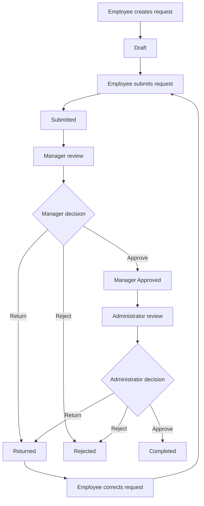

### Workflow Explanation

1. The employee creates a request and saves it as a draft.
2. The employee submits the request.
3. The manager starts reviewing the submitted request.
4. The manager can approve, return, or reject the request.
5. Manager-approved requests move to administrator review.
6. The administrator can approve, return, or reject the request.
7. Final administrator approval marks the request as completed.
8. Returned requests can be corrected and resubmitted by the employee.

## Request Statuses

The application defines the following request statuses:

| Status | Description |
|---|---|
| `DRAFT` | Request created but not submitted |
| `SUBMITTED` | Request submitted by the employee |
| `MANAGER_REVIEW` | Manager is reviewing the request |
| `MANAGER_APPROVED` | Manager has approved the request |
| `ADMIN_REVIEW` | Administrator is reviewing the request |
| `APPROVED` | Approval action recorded in the workflow |
| `RETURNED` | Request returned for corrections |
| `REJECTED` | Request rejected during an approval stage |
| `COMPLETED` | Final administrator approval completed |

The final approval operation transitions the request to `COMPLETED`.

## Technology Stack

| Layer | Technologies |
|---|---|
| Frontend | React.js, JavaScript, HTML, CSS |
| Build Tool | Vite |
| Backend | Java, Spring Boot |
| Security | Spring Security, JWT |
| Database | MySQL |
| ORM | Spring Data JPA, Hibernate |
| API | REST APIs |
| Build Management | Maven |
| Testing | JUnit, Mockito, Spring Boot Test, ESLint |
| Deployment Setup | Docker, Docker Compose |

## Project Architecture

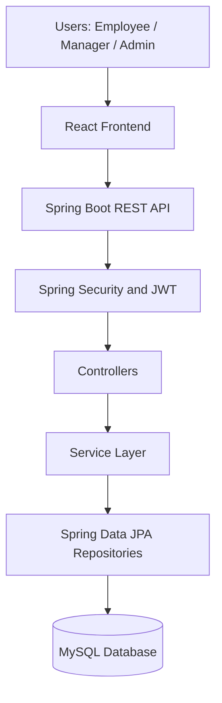

### Architecture Overview

- **Frontend:** Provides user interfaces and role-specific dashboards.
- **Backend:** Handles business logic, request processing, and approval operations.
- **Security:** Protects application endpoints using authentication and role-based authorization.
- **Database:** Stores users, requests, request types, approval history, and audit information.
- **Workflow Services:** Enforce the manager and administrator approval sequence.

## Project Structure

```text
document-approval-workflow/
│
├── backend/
│   ├── src/
│   │   ├── main/
│   │   │   ├── java/
│   │   │   └── resources/
│   │   └── test/
│   ├── Dockerfile
│   └── pom.xml
│
├── frontend/
│   ├── src/
│   │   ├── api/
│   │   ├── components/
│   │   └── ...
│   ├── .env.example
│   └── package.json
│
├── docs/
│   ├── database-design.md
│   ├── requirements.md
│   └── workflow.md
│
├── docker-compose.yml
├── .gitignore
└── README.md
```

## Getting Started

### Prerequisites

Install the following:

- Java 17 or compatible version required by the backend configuration.
- Maven.
- Node.js and npm.
- Docker Desktop or Docker Engine with Docker Compose.
- Git.

### 1. Clone the Repository

```bash
git clone https://github.com/mahesh001-sys/document-approval-workflow.git

cd document-approval-workflow
```

### 2. Configure Environment Variables

Create a root `.env` file for Docker Compose configuration.

Create a frontend environment file:

```bash
cp frontend/.env.example frontend/.env
```

Set the frontend API URL to the backend address used by your environment.

Do not commit `.env` files or expose database passwords and JWT secrets.

See the [Environment Configuration](#environment-configuration) section.

### 3. Start the Backend and Database

After configuring the required root environment variables, run:

```bash
docker compose up --build -d
```

Check the running containers:

```bash
docker compose ps
```

View application logs:

```bash
docker compose logs -f backend
```

### 4. Start the Frontend

Open another terminal:

```bash
cd frontend

npm install

npm run dev
```

Open the Vite development URL shown in your terminal.

### 5. Stop the Application

```bash
docker compose stop
```

To stop and remove containers without deleting persistent database volumes:

```bash
docker compose down
```

**Important:** Do not use `docker compose down -v` if you want to preserve your database data.

## Environment Configuration

### Backend and Docker Compose

Configure the variables required by your `docker-compose.yml` and Spring Boot application.

| Variable | Purpose |
|---|---|
| `MYSQL_DATABASE` | MySQL database name |
| `MYSQL_USER` | MySQL application user |
| `MYSQL_PASSWORD` | MySQL application password |
| `MYSQL_ROOT_PASSWORD` | MySQL root password |
| `DB_USERNAME` | Backend database username |
| `DB_PASSWORD` | Backend database password |
| `JWT_SECRET` | Secret used for JWT signing |
| `CORS_ALLOWED_ORIGINS` | Allowed frontend origins, if configured |

Use a securely generated JWT secret. Never publish its actual value.

### Frontend

Configure:

```env
VITE_API_BASE_URL=http://localhost:8080/api
```

Adjust the URL to match your backend deployment.

Do not commit environment files containing secrets.

## API Documentation

The backend exposes REST APIs for authentication, users, requests, and approval workflow operations.

When the backend is running, Swagger UI is available at:

```text
http://localhost:8080/swagger-ui/index.html
```

The OpenAPI specification is available at:

```text
http://localhost:8080/v3/api-docs
```

## Testing and Verification

The following checks were previously verified during project development:

### Backend

- 70 backend tests passed.
- Authentication and authorization tests.
- Request service tests.
- Approval workflow tests.
- JWT authentication tests.
- Exception handling tests.

### Frontend

- ESLint checks passed.
- Vite production build completed successfully.

### Workflow Verification

The end-to-end approval process was tested:

- Employee request creation and submission.
- Manager review and approval.
- Administrator final approval.
- Request completion.
- Approval history and audit log verification.

**Verification note:** These are previously recorded development results, not a claim that the tests were rerun against every subsequent change.

To rerun the checks:

Backend:

```bash
cd backend
mvn test
```

Frontend:

```bash
cd frontend
npm run lint
npm run build
```

## Screenshots

### Home Page

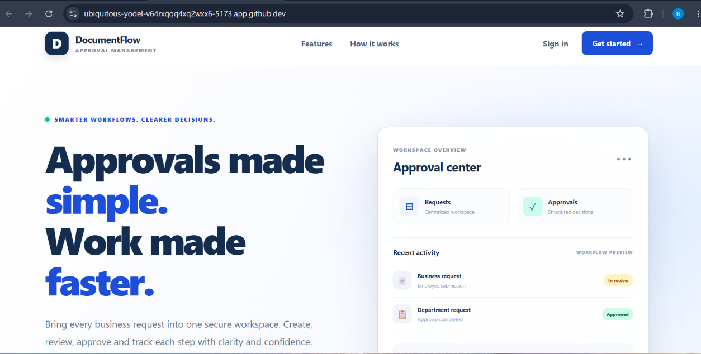

### Login Pages

| Employee Login | Manager Login | Admin Login |
|---|---|---|
| 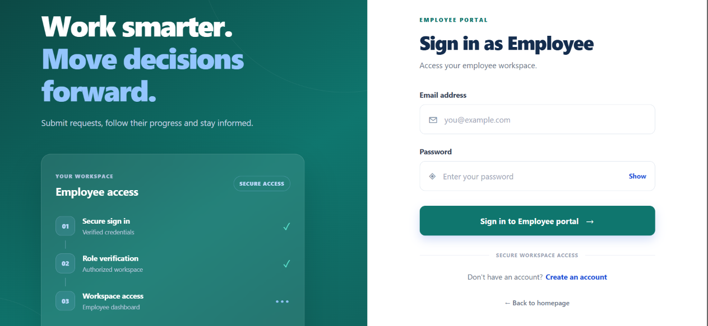 | 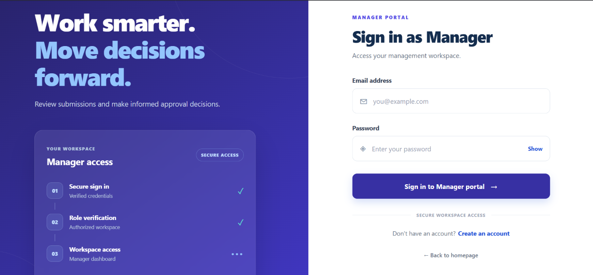 | 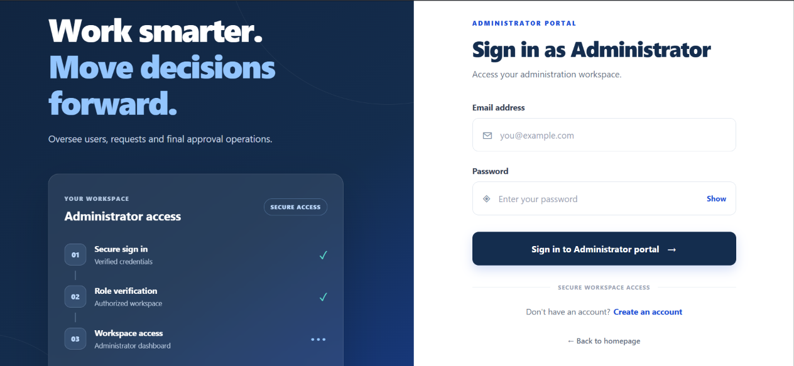 |

### Login Interface

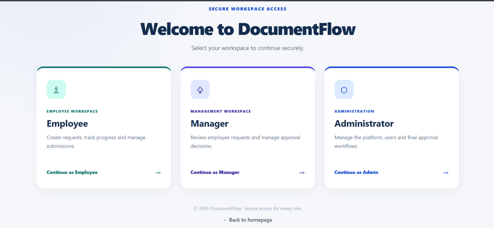

### Dashboards

#### Employee Dashboard
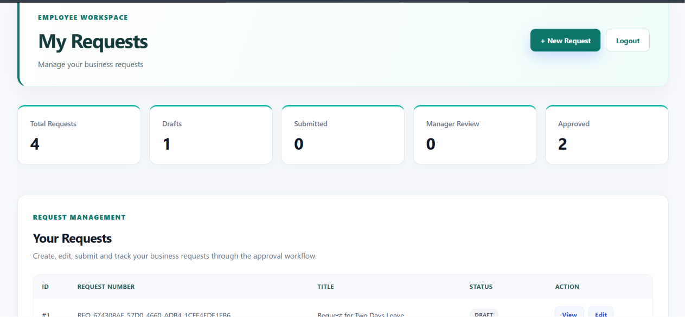

#### Manager Dashboard
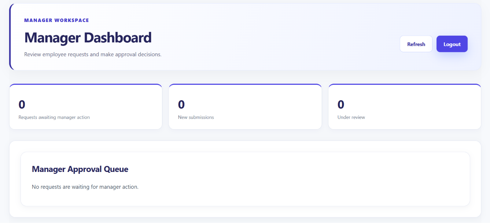

#### Admin Dashboard
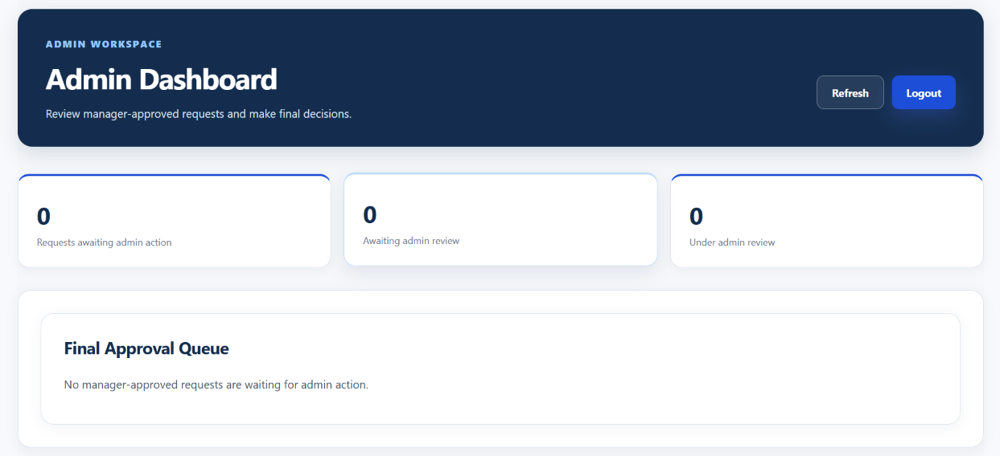

### Approval History

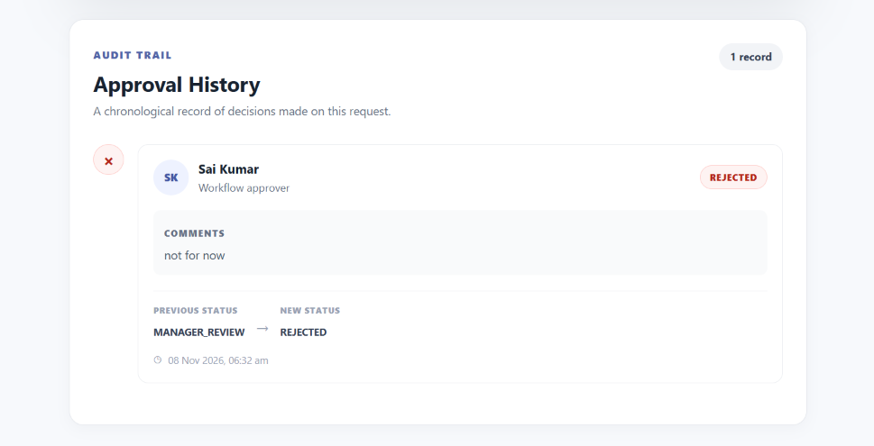

## Current Limitations

- File attachment upload and storage are not verified as implemented.
- Production deployment has not yet been completed and verified.
- Deployment-specific environment configuration is still required.

## Future Enhancements

- Supporting document and receipt upload with secure storage.
- Email notifications.
- Advanced request filtering and reporting.
- Enhanced dashboard analytics.
- Production deployment and monitoring.
- Additional automated integration and end-to-end tests.

## Author

**Mahesh Kumar**

B.Tech Information Technology Graduate

GitHub: [mahesh001-sys](https://github.com/mahesh001-sys)

Project Repository: [Document Approval Workflow System](https://github.com/mahesh001-sys/document-approval-workflow)

---

*Built with React, Spring Boot, Spring Security, JWT, and MySQL.*
